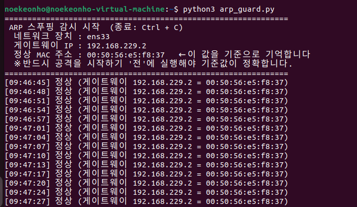
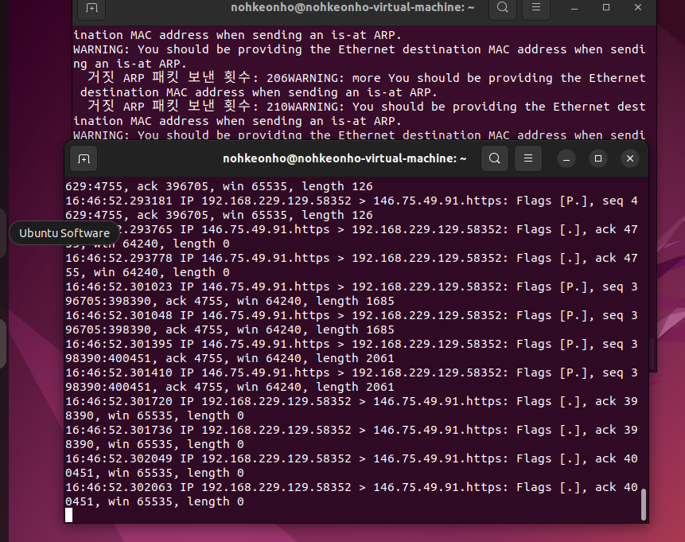
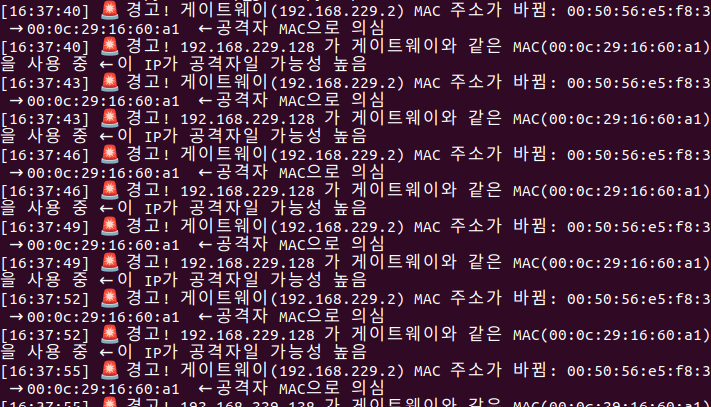
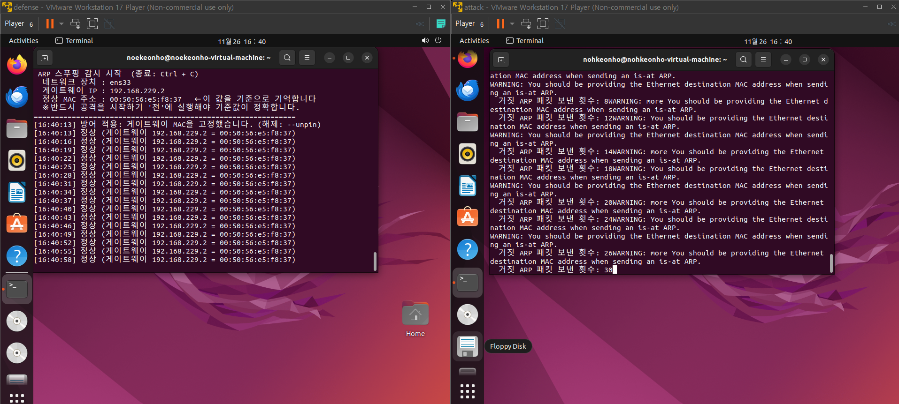
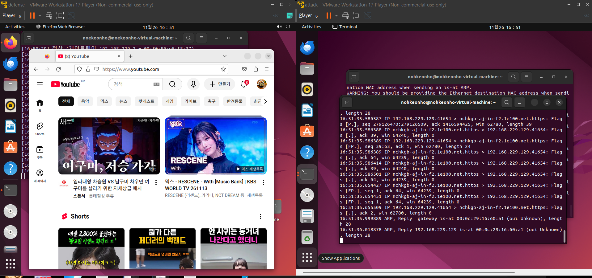

# ARP 스푸핑 중간자 공격(MitM) 및 방어 실습

사이버보안개론 3조 실습 **「ARP 스푸핑을 이용한 중간자 공격(MitM) 및 방어 실습」** 코드입니다.

공격자 PC가 ARP 스푸핑으로 피해자의 통신을 가로채고(중간자 공격), 피해자 PC가 이를 탐지·차단하는 과정을 직접 실습합니다.

> ⚠️ **주의**
> 이 저장소는 교육 목적의 실습 자료입니다.
> 실습은 **본인 소유의 가상머신(VMware NAT 네트워크)** 안에서만 진행하세요.
> 학교·카페 등 공용 네트워크에서 다른 사람을 대상으로 ARP 스푸핑을 하는 것은 불법입니다.

---

## 1. 동작 원리

ARP 스푸핑 공격자는 "내가 공유기(게이트웨이)야"라고 속여서, 피해자 PC의 **ARP 표**에 적힌 게이트웨이 MAC 주소를 자기 MAC 주소로 바꿉니다. 그러면 피해자의 인터넷 통신이 모두 공격자를 거쳐 가게 됩니다(중간자 공격, MitM).

| 역할 | 코드 | 하는 일 |
|---|---|---|
| **공격** | `arp_attack.py` | 피해자·게이트웨이에게 거짓 ARP 응답을 반복해 보내 통신을 가로챔 |
| **방어 — 탐지** | `arp_guard.py` | ARP 표를 3초마다 읽어 게이트웨이 MAC 변화를 감지해 경고 |
| **방어 — 차단** | `arp_guard.py --pin` | 게이트웨이 MAC을 정적(permanent)으로 고정해 공격을 무력화 |

## 2. 실습 환경

| 항목 | 내용 |
|---|---|
| 호스트 | 노트북·데스크톱 **1대** |
| 가상머신 | VMware Workstation 17 Player, Ubuntu VM **2대** (공격자 / 피해자) |
| 운영체제 | Ubuntu 22.04 LTS (Ubuntu 20.04 이상이면 동작) |
| 네트워크 | 두 VM 모두 **NAT** (같은 가상 네트워크에 있어야 함) |

컴퓨터 1대 안에서 Ubuntu VM 2대를 띄워 진행합니다. 두 VM이 **같은 NAT 네트워크**에 있으므로 실제 PC 2대처럼 서로 통신하며, 공격·방어가 호스트 바깥으로 나가지 않아 안전합니다.

실습에 사용한 IP (예시):

| 역할 | IP | MAC |
|---|---|---|
| 게이트웨이 | 192.168.229.2 | `00:50:56:e5:f8:37` (진짜) |
| 피해자 | 192.168.229.129 | — |
| 공격자 | 192.168.229.128 | `00:0c:29:16:60:a1` |

### 필요 프로그램

| VM | 필요 프로그램 | 설치 |
|---|---|---|
| 피해자 VM (`arp_guard.py`) | `python3`, `ip`, `ping` | Ubuntu 기본, 추가 설치 없음 |
| 공격자 VM (`arp_attack.py`) | `python3`, **Scapy** | 아래 참고 |

> **Scapy 설치 주의**: 공격 코드는 `sudo`로 실행하므로 root도 Scapy를 볼 수 있게 설치해야 합니다.
> 최신 Ubuntu는 `apt`에 `python3-scapy`가 없을 수 있으니 pip로 설치하세요.
> ```bash
> sudo pip3 install scapy
> # (오류 시) sudo pip3 install scapy --break-system-packages
> sudo python3 -c "import scapy; print('ok')"   # ok 나오면 성공
> ```

## 3. 실행 방법

먼저 **피해자 VM**에서 `ip route`로 IP를 확인합니다.
(`default via ...2` 가 게이트웨이, `src ...` 가 피해자 IP. `게이트웨이를 찾지 못했습니다`가 나오면 `sudo dhclient`로 네트워크를 다시 받으세요.)

**① 피해자 VM — 감시 시작** (반드시 공격 전에 실행)
```bash
python3 arp_guard.py
```

**② 공격자 VM — 공격 시작** (파일이 있는 폴더에서)
```bash
sudo python3 arp_attack.py -t 192.168.229.129 -g 192.168.229.2
```
→ 피해자 VM 화면에 `🚨 경고!`가 뜨면 **탐지 성공**

**③ 공격자가 보는 트래픽 확인** (공격 중, 공격자 VM 새 터미널)
```bash
sudo tcpdump -i ens33 host 192.168.229.129
```

**④ 방어 적용** — 피해자 VM에서
```bash
sudo python3 arp_guard.py --pin
```
→ 다시 공격해도 `정상`이 유지되면 **차단 성공**
(시작 시 "이미 공격받는 중" 경고로 멈추면, 공격을 잠깐 멈추고 `--pin` 건 뒤 다시 공격하세요)

**⑤ 실습 종료 후 원상복구**
```bash
# 피해자 VM
sudo python3 arp_guard.py --unpin
# 공격자 VM: Ctrl + C (피해자 ARP 표 자동 복구)
```

## 4. 실습 결과

### 4-0. 정상 상태 (공격 전 기준)
공격을 시작하기 전, `arp_guard.py`가 게이트웨이 MAC `00:50:56:e5:f8:37`을 정상값으로 기억하고 `정상`을 반복 출력합니다. 이 값을 기준으로 이후 변화를 감지합니다.


### 4-1. 공격 성공 (중간자 공격)
공격 중 공격자 VM의 tcpdump에 피해자의 웹 트래픽(유튜브 등)이 그대로 잡힙니다. 피해자 통신이 공격자를 경유한다는 증거입니다. 단, HTTPS 트래픽이라 통신 상대·양은 보여도 내용은 암호화되어 보이지 않습니다.


### 4-2. 탐지 성공
피해자 VM의 `arp_guard.py`가 게이트웨이 MAC이 `00:50:56:e5:f8:37`(진짜) → `00:0c:29:16:60:a1`(공격자)로 바뀐 것을 감지하고, 같은 MAC을 쓰는 `192.168.229.128`을 공격자로 특정했습니다.


### 4-3. 차단 성공
`--pin`으로 게이트웨이 MAC을 고정하자, 공격자가 계속 거짓 ARP를 보내도(오른쪽) 피해자의 ARP 표는 진짜 MAC `00:50:56:e5:f8:37`을 유지합니다(왼쪽 `정상`).


## 5. 고찰 — 호스트 단독 방어의 한계

`--pin`(정적 ARP) 방어를 켠 상태에서도 공격자의 tcpdump에는 피해자의 수신 트래픽이 계속 보입니다. 이는 방어 실패가 아니라 ARP 방어의 구조적 특성입니다.



| 경로 | 참조하는 ARP 표 | `--pin` 적용 시 | 결과 |
|---|---|---|---|
| 피해자 → 서버 (송신) | **피해자**의 ARP 표 | 고정됨 ✅ | 진짜 게이트웨이로 전송, 공격자 우회 안 함 |
| 서버 → 피해자 (수신) | **게이트웨이**의 ARP 표 | 고정 불가 ❌ | 여전히 공격자를 경유 |

`--pin`은 피해자 **자신의** ARP 표만 고정하므로 **송신 방향**만 보호됩니다. 공격자가 게이트웨이에게도 "피해자는 나"라고 속인 것은, 게이트웨이(공유기·NAT 장치)의 ARP 표를 피해자가 제어할 수 없어 막지 못합니다.

그럼에도 의미는 큽니다. 송신 방향이 보호되면 **피해자가 입력하는 비밀번호·검색어 등 민감한 데이터가 공격자로 유출되지 않습니다.** 완전한 양방향 차단을 위해서는 게이트웨이에서도 정적 ARP를 설정해야 하며, 이는 호스트 기반 단독 방어의 한계를 보여줍니다.

## 6. 기타 한계

- 공격 코드에는 비밀번호 자동 추출 기능을 넣지 않았습니다. 방어 시연에 불필요하고 악용 위험만 커지기 때문이며, 트래픽 확인은 tcpdump/Wireshark로 합니다. 내용 스니핑을 보려면 HTTPS가 아닌 HTTP(평문) 테스트 페이지에 접속해야 합니다.
- 탐지는 ARP 표를 3초 간격으로 확인하므로, 그 사이 짧은 변화는 놓칠 수 있습니다.

## 7. 파일 구성

```
.
├── arp_attack.py   # 공격: ARP 스푸핑 (Scapy, 공격자 VM)
├── arp_guard.py    # 방어: 탐지 + MAC 고정 (피해자 VM)
├── README.md       # 이 문서
├── .gitignore      # 로그 파일 제외
└── images/         # 실습 결과 캡처 (00_normal, 01_attack, 02_detected, 03_defended)
```
